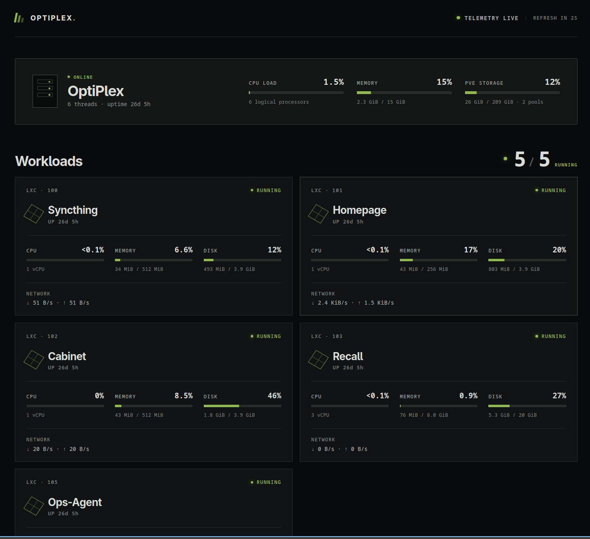
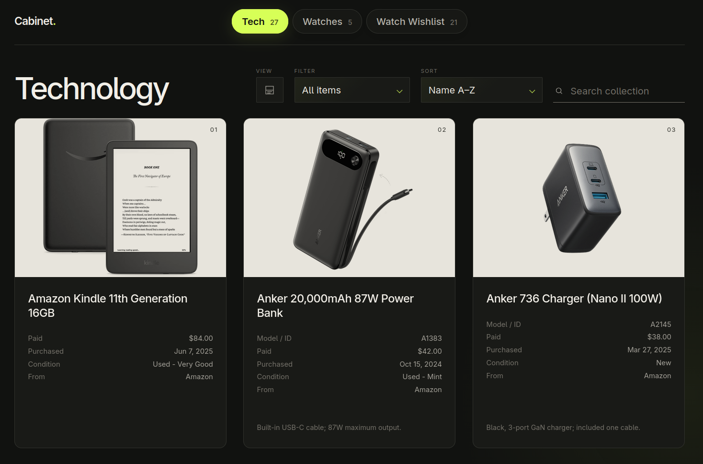

# Building a Proxmox Homelab on a $130 eBay OptiPlex

I wanted an affordable, quiet machine to run my own services at home without relying on cloud subscriptions or exposing ports to the public internet. I picked up a used Dell OptiPlex 3060 SFF on eBay for $130, installed Proxmox VE 9.2, and built a homelab with lightweight Linux containers (LXC) and Tailscale for private remote access.

## Hardware and Hypervisor

* **System:** Dell OptiPlex 3060 SFF
* **Processor:** Intel Core i5-8500 (6 cores)
* **Memory:** 16 GB DDR4
* **Storage:** 256 GB SSD
* **Hypervisor:** Proxmox VE 9.2

This small-form-factor desktop gives me plenty of headroom to run several self-hosted services. Each workload runs in its own unprivileged container, with resources allocated according to its needs. With all services running, baseline host CPU usage sits around 1.3%, and memory usage hovers near 2.3 GiB.

## Redesigning the Network Around Managed Wi-Fi

At my previous home, networking was straightforward: I could plug the OptiPlex directly into an Ethernet port. Proxmox's standard network bridge used that physical connection, so both the host and its containers could get online out of the box.

After I moved, I no longer had access to an Ethernet port. My only option was a managed Wi-Fi network with an upstream router I couldn't configure. Because Proxmox's standard Ethernet bridge cannot natively bridge multiple container MAC addresses over a client Wi-Fi connection, I had to rethink how the host and its containers connected to the network.

I left the physical Ethernet interface and its default bridge unused, then connected the Proxmox host directly to Wi-Fi using DHCP. Since the IP address assigned by the upstream router can change, I installed Tailscale on the host to give myself a reliable, private way to reach Proxmox.

For the containers, I created a private Proxmox SDN network. This internal network does not use DHCP, so I assign each container a unique static IP address. Proxmox handles outbound internet access using source NAT (SNAT). I also configured the host to advertise the container subnet to my tailnet, so I only need to install Tailscale on the host. My laptop and phone can then reach any service over Tailscale without exposing those services to the public internet.

## What I Run

Every service runs in its own unprivileged Linux container configured to boot automatically with Proxmox.

### Syncthing

Syncthing runs in a lightweight container with 1 vCPU, 512 MiB of memory, and a 4 GiB root disk. It continuously syncs my Obsidian vault between my laptop and the server, keeping an up-to-date copy of my notes on both machines.

### Homepage

Homepage is my private Proxmox resource dashboard. It runs on 1 vCPU, 256 MiB of memory, and a 4 GiB root disk. It polls the hypervisor for live metrics, including CPU and memory usage for the host and containers, storage pool information, network traffic, uptime, and container status.

### Cabinet

Cabinet is a personal static website that catalogs my tech, my watch collection, and my watch wishlist. It runs on 1 vCPU, 512 MiB of memory, and a 4 GiB root disk. I keep the entries in Markdown, build them into a static site, and serve it with Caddy.

### Recall (In Progress)

Recall is a private spaced-repetition app I'm building. It uses a local Ollama model to turn my curated Markdown notes into flashcards and schedules reviews with FSRS. Because it runs AI inference locally, I've given it the largest share of resources in the lab: 3 vCPUs, 8 GiB of memory, and a 20 GiB root disk. I cap Recall's Ollama service at half of the host's CPU and memory resources to leave capacity for Proxmox and the other containers.

Recall also runs separately from my Syncthing workflow. It reads only the `Memorize/` folder from a dedicated Git sparse checkout of my notes repository, leaving the live synced vault untouched. My Markdown notes remain the single source of truth, while Recall generates flashcards and stores review progress locally.

## Security and Operations

Even though none of my services are exposed to the public internet, I set up the lab around least-privilege access. All workloads run inside unprivileged containers, and I reach their web interfaces exclusively through Tailscale and the host's subnet route. Services that need external access only get the minimum permissions required for their job. The Homepage dashboard authenticates to Proxmox using a dedicated read-only API token, and Recall pulls notes using a repository-scoped, read-only GitHub deploy key rather than a personal access token with write permissions.
